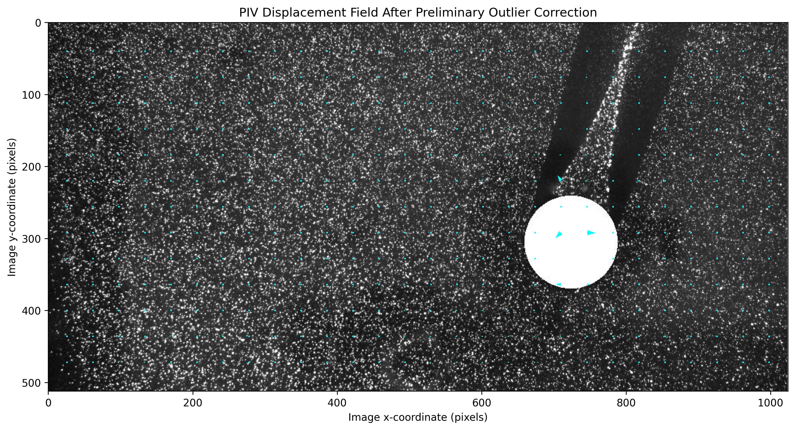

# PIV-Based Cylinder Wake Analysis

## Project Overview
This project explores particle image velocimetry (PIV) processing using
Python and OpenPIV. An image pair containing a circular obstacle is analysed
to estimate particle-image displacement fields and examine their spatial
variation downstream of the obstacle.

## Tools
- Python
- NumPy
- Matplotlib
- OpenPIV
- Pandas

## Methodology
1. Load the two images as grayscale arrays.
2. Estimate displacement using OpenPIV extended-search-area PIV.
3. Apply signal-to-noise validation.
4. Investigate unusually large vectors using a local-median comparison.
5. Create a separate diagnostic field with three candidate outliers replaced
   by local-median estimates.
6. Plot horizontal and vertical displacement components.
7. Compare horizontal displacement across five neighbouring grid rows.
8. Export the downstream profile statistics to CSV.

## Reproducibility

The complete Google Colab notebook, including the analysis workflow and code, is available here:

- [Open the PIV analysis notebook](wake_analysis.ipynb)

The notebook uses OpenPIV to estimate image-plane displacement, identify potential outliers, and examine a preliminary downstream displacement profile.

## Preliminary PIV Results

The figure below shows the particle-image-velocimetry (PIV) displacement field after preliminary outlier correction. The vectors represent image-plane displacement in pixels per frame, not calibrated physical velocities.

### Output files

- [Download the downstream displacement profile (CSV)](downstream_displacement_profile.csv)
- [View the PIV displacement-field plot](cleaned_piv_displacement.png)
  

## Preliminary Processing Settings
- Window size: 24 pixels
- Search area size: 48 pixels
- Overlap: 12 pixels
- Correlation method: linear
- Normalized correlation: enabled
- Signal-to-noise screening threshold: 1.3

## Preliminary Observation
Across five selected grid rows, the mean horizontal image displacement
becomes more consistent at downstream sample positions. At x = 998 pixels,
the mean is approximately -2.038 pixels per image pair, with a
between-row standard deviation of approximately 0.039 pixels per image pair.

These are preliminary image-displacement statistics, not calibrated flow
velocities or proof of wake recovery.

## Limitations and Next Steps
- Verify the dataset's provenance and the physical meaning of the image pair.
- Establish the actual frame interval and spatial calibration before
  calculating velocities in physical units.
- Investigate masked regions and correlation quality near the obstacle.
- Validate outlier detection and replacement against the raw measurements.
- Compare the measured field with an appropriate reference dataset or
  published benchmark before making physical claims.

## Output
- - [Download the downstream displacement profile](downstream_displacement_profile.csv)

## Reproducibility
The analysis is being developed in Google Colab. The notebook and figures
should be committed alongside the output data, with the dataset source
and applicable licence documented.
